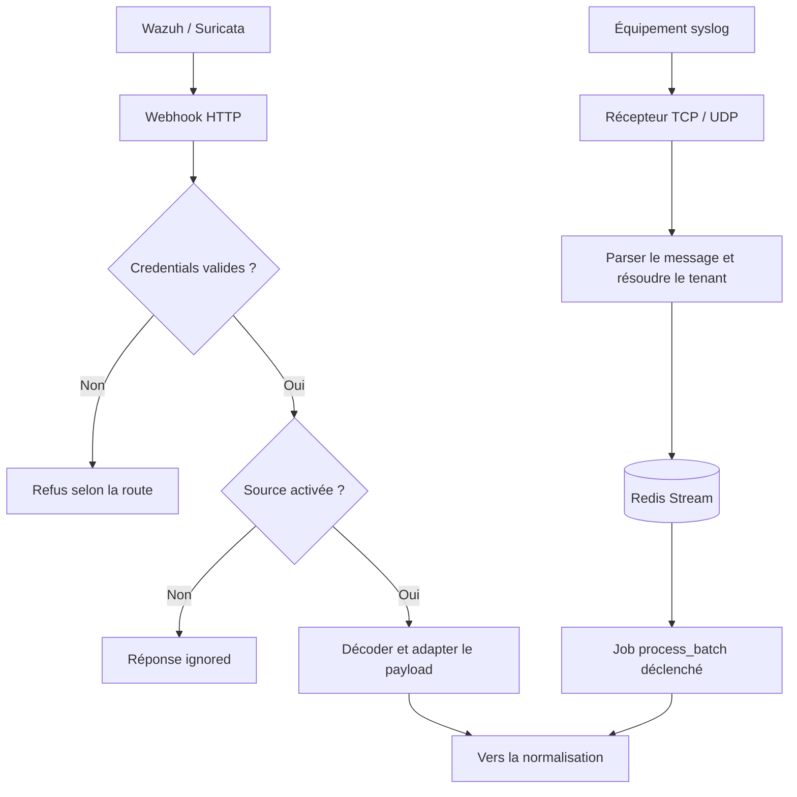
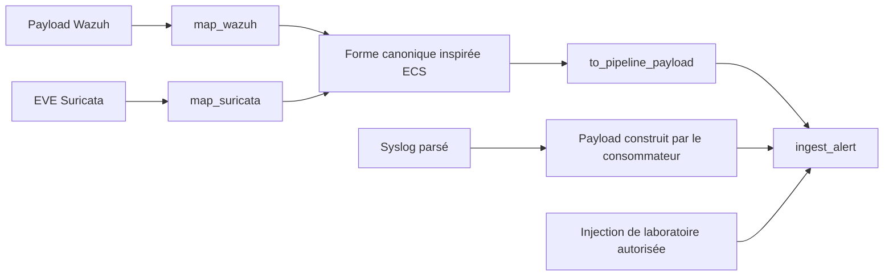
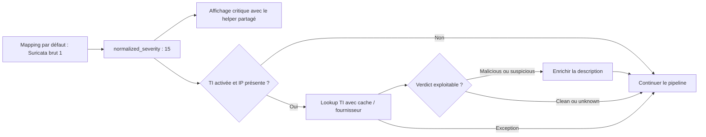
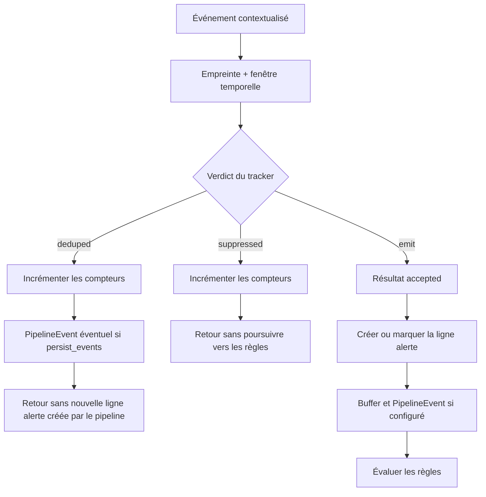
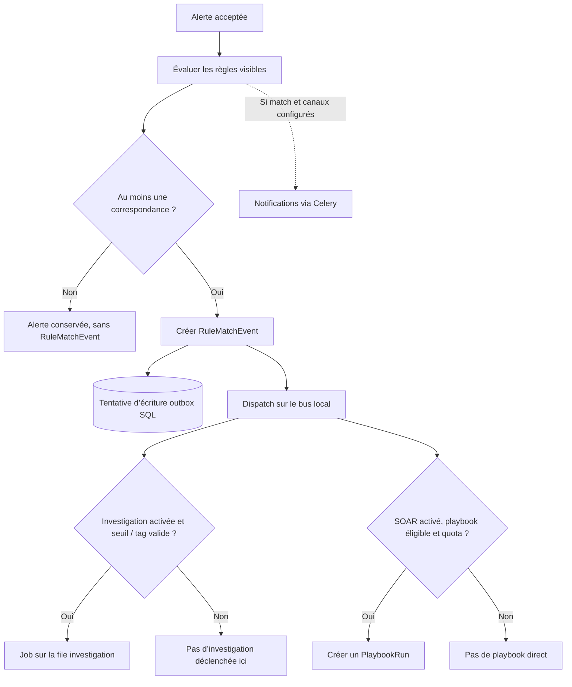
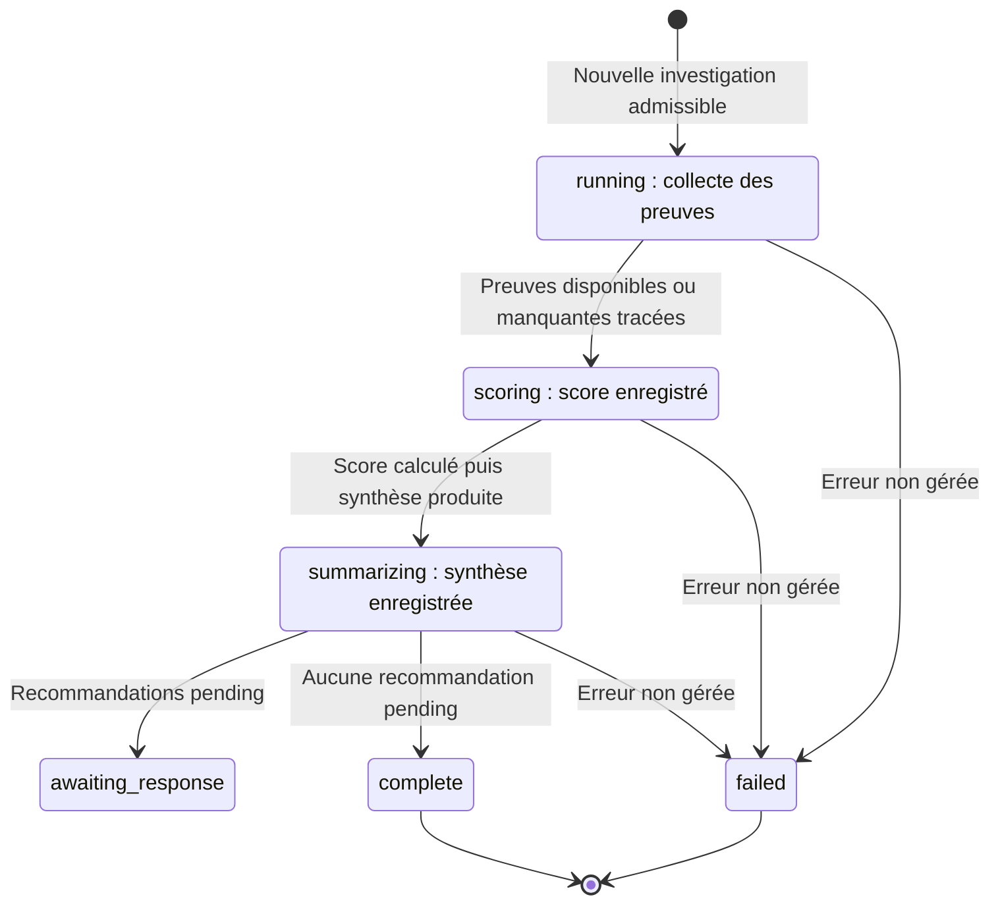
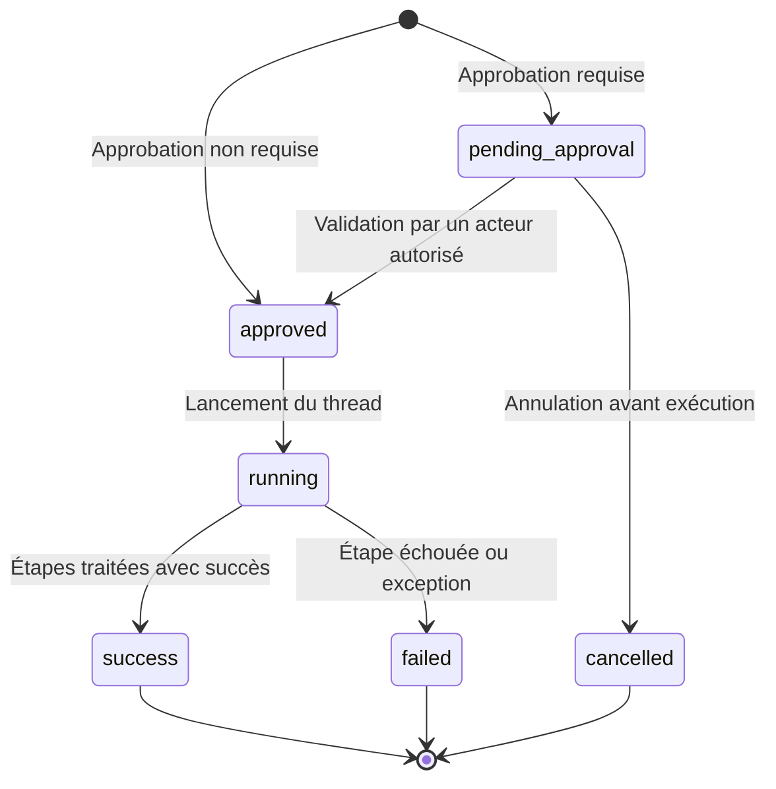
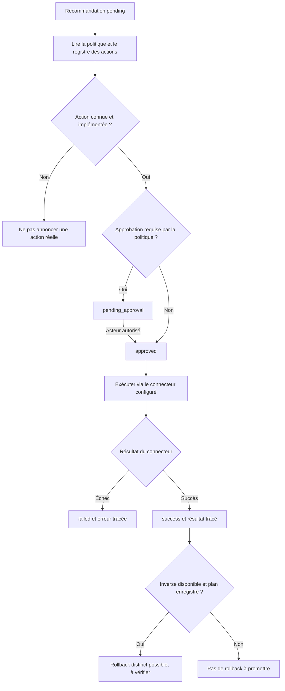
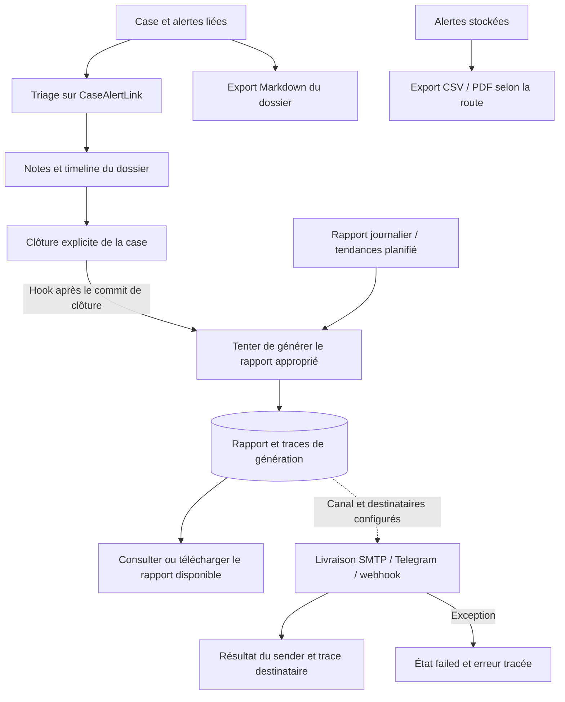
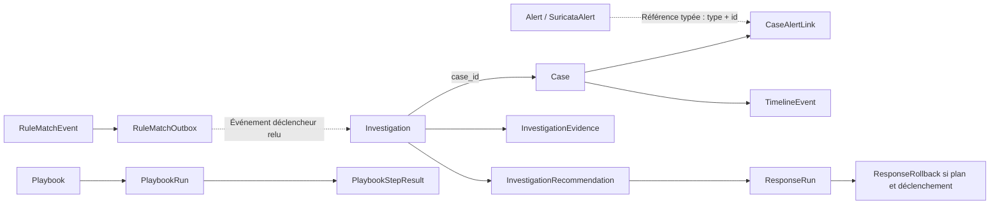

# Guide visuel — architecture et parcours SOC

[← README](../README.md) · [Nature](#nature) · [Composants](#composants) · [Les 8 étapes](#etapes) · [Données](#donnees) · [Avantages](#valeur) · [Modifier les visuels](#maintenance)

**Version interactive :** ouvrir [index.html](index.html) dans un navigateur, directement depuis le dépôt ou via le serveur de documentation décrit dans le [README](../README.md). Elle ajoute 14 composants cliquables, huit fiches d’étape, une navigation clavier et le zoom des SVG, sans connexion à l’API ni dépendance externe. Sur GitHub, ce lien ouvre la source HTML.

**Objectif :** comprendre ce que le projet est, qui intervient, comment circule un événement et quel apport vise chaque mécanisme. Les schémas décrivent le code présent ; ils ne représentent pas une infrastructure de production certifiée.

> [!NOTE]
> Un événement accepté n’engendre pas systématiquement une investigation, un playbook, un blocage ou un rapport. Les flags, les règles, les quotas, les permissions et la disponibilité des connecteurs déterminent les branches réellement parcourues. L’ordre 01–08 est un **fil de lecture**, pas une transaction obligatoire unique.

## Comment lire ce guide

| Repère | Signification |
| :--- | :--- |
| Vert / bleu dans les SVG | Composants et traitements décrits dans le dépôt. Cela ne signifie pas « service actuellement sain ». |
| Jaune et pointillés | Parcours conditionnel ou intégration à configurer. Aucune activation automatique n’est suggérée. |
| `accepted`, `deduped`, `suppressed` | Résultats du pipeline ; ne pas les confondre avec les statuts d’une investigation ou d’une action. |
| **Entrée → traitement → sortie** | Ce qui entre, le mécanisme appliqué et le résultat à observer. |
| **Avantage attendu** | Apport qualitatif du mécanisme, pas un gain mesuré ni un SLA. |

Les SVG restent visibles sans moteur Mermaid. Les schémas Mermaid donnent le détail des décisions sur GitHub. Chaque partie renvoie au code correspondant pour permettre de vérifier le comportement.

<a id="nature"></a>

## Vue A · Quelle est la nature du projet ?


[Ouvrir le SVG](assets/project-nature.svg)

- **Nature technique :** un monorepo avec un backend FastAPI modulaire, deux applications React, des jobs Celery et des services externes. Ce n’est pas un découpage complet en microservices.
- **Nature fonctionnelle :** un socle SOC/SIEM avec des parcours d’investigation multi-sources et d’orchestration SOAR.
- **Nature pédagogique :** une base de laboratoire/PFE pour montrer les mécanismes de normalisation, corrélation, accès et réponse.
- **Périmètre à ne pas surévaluer :** pas d’IPS Suricata inline, pas de paiement intégré validé, pas de garantie de conformité ou de protection biométrique forte.

| Acteur | Rôle dans le parcours | Limite |
| :--- | :--- | :--- |
| Analyste autorisé | Lire les signaux, trier, investiguer et documenter un dossier. | Ses droits dépendent des policies et des scopes, pas seulement de son écran. |
| Opérateur autorisé | Configurer les sources, les accès, les canaux et les politiques de réponse. | Une configuration valide ne prouve pas qu’un équipement externe est joignable. |
| Worker / scheduler | Exécuter les jobs et déclencher les travaux périodiques configurés. | Un job envoyé n’est pas une preuve d’exécution ou de succès. |
| Développeur | Étendre les adaptateurs et ajouter des tests de non-régression. | Une simulation doit rester explicitement identifiée. |

<a id="composants"></a>

## Vue B · Quels composants communiquent ?


[Ouvrir le SVG](assets/architecture-map.svg)

### Trois mécanismes à ne pas confondre

| Mécanisme | Où il vit | Ce qu’il transporte / conserve | Ce qu’il ne garantit pas |
| :--- | :--- | :--- | :--- |
| **Bus d’événements local** | Dans le processus Python qui le charge. | Appels aux handlers abonnés, notamment sur `rules.match`. | Ce n’est pas un broker réseau partagé automatiquement entre tous les processus. |
| **Outbox SQL** | Table `RuleMatchOutbox` en PostgreSQL/SQLite selon l’environnement. | Payload et état des correspondances de règles. | L’écriture et l’action externe ne constituent pas une transaction distribuée atomique. |
| **Redis / Celery / Streams** | Services et processus séparés. | Jobs, résultats, rate-limit et messages syslog selon le parcours. | Un message publié ne démontre ni qu’un worker écoute sa file, ni que l’action finale réussit. |

### Qui exécute réellement le travail ?

| Travail | Exécuteur visible dans le code | Condition importante |
| :--- | :--- | :--- |
| Mapping, sévérité, déduplication et règles | Chemin synchrone du pipeline appelé par le handler. | L’enrichissement TI optionnel se trouve aussi avant la déduplication. |
| Investigation déclenchée par une règle | Tâche Celery `jobs.investigation.run_investigation`. | Routée vers la file **`investigation`** ; un worker doit la consommer. |
| Playbook SOAR direct | `threading.Thread` lancé dans le processus appelant. | Ce n’est pas un job Celery durable par simple présence du worker. |
| Recommandation de réponse | `ResponseRun` et jobs du module de réponse. | Activation, action implémentée et approbation peuvent être requises. |
| Rapports, rétention, rattrapage et autres jobs | Celery et Beat selon la planification. | Un seul scheduler pour éviter les lancements périodiques en double. |
| Réception syslog | Processus autonome TCP/UDP → Redis Stream. | Le consommateur `jobs.syslog.process_batch` doit être déclenché ; pas de boucle Beat dédiée actuellement. |

Pour le laboratoire, un worker général qui doit aussi traiter les investigations peut être lancé depuis `backend/`, venv activé :

```bash
celery -A app.core.celery:celery_app worker \
  --include app.worker --queues celery,investigation \
  --loglevel=info --pool=solo \
  --beat --schedule /tmp/sentinel-celerybeat
```

Cette commande décrit un laboratoire, pas une stratégie de supervision en production. Le [README](../README.md#demarrage) détaille l’environnement et les processus.

**Code de référence :** [composition FastAPI](../backend/app/interface/main.py), [bootstrap](../backend/app/application/bootstrap.py), [bus / outbox](../backend/app/application/events.py), [application Celery](../backend/app/core/celery.py), [tâches d’investigation](../backend/app/infrastructure/jobs/investigation_tasks.py), [exécuteur SOAR](../backend/app/application/soar/executor.py).

<a id="etapes"></a>

## Vue C · Comment se déroule le parcours en huit étapes ?


[Ouvrir le SVG](assets/incident-lifecycle.svg)

| Étape | Question traitée | Sortie à observer | Avantage attendu |
| :--- | :--- | :--- | :--- |
| [01 · Collecter](#etape-01) | D’où vient le signal et par quel canal entre-t-il ? | Payload webhook ou événement du Stream. | Réunir plusieurs sources dans un parcours explicable. |
| [02 · Structurer](#etape-02) | Comment lire des formats différents ? | Événement canonique et contexte tenant. | Faciliter les traitements communs sans effacer l’origine. |
| [03 · Contextualiser](#etape-03) | Que signifie la gravité et y a-t-il du contexte TI ? | `normalized_severity` et enrichissement éventuel. | Prioriser sans inverser l’échelle Suricata ni assimiler `unknown` à `clean`. |
| [04 · Dédupliquer](#etape-04) | Est-ce une répétition dans la fenêtre courante ? | `accepted`, `deduped` ou `suppressed`. | Éviter de faire progresser chaque répétition vers les règles. |
| [05 · Corréler](#etape-05) | Une règle explique-t-elle ce signal ? | Correspondances et `RuleMatchEvent` si match. | Donner un motif de détection et choisir les suites configurées. |
| [06 · Investiguer](#etape-06) | Quelles preuves et quel contexte sont disponibles ? | Case, preuves, score, synthèse et recommandations selon l’issue. | Rendre l’analyse partageable et explicite. |
| [07 · Décider / répondre](#etape-07) | Une action est-elle autorisée, implémentée et approuvée ? | Attente, succès ou échec tracé. | Conserver la décision humaine lorsque requise et vérifier le résultat. |
| [08 · Capitaliser](#etape-08) | Comment conserver et restituer ce qui s’est passé ? | Timeline, clôture explicite, rapport/export et état de livraison. | Réutiliser le contexte et communiquer les résultats. |

<a id="etape-01"></a>

## Étape 01 · Collecter sans confondre réception et acceptation

**Entrée :** événement Wazuh, EVE Suricata, message syslog ou injection de laboratoire. Les mécanismes d’identité ne sont pas identiques : les webhooks utilisent les credentials prévus par leurs routes ; le récepteur syslog résout notamment le tenant à partir de l’IP/mapping, sans authentification JWT équivalente.



**Sortie :** une donnée transmise au pipeline, ou un refus/état ignoré/erreur. **HTTP 200 n’est pas une preuve d’ingestion** : contrôler le corps de la réponse et les compteurs. Le récepteur syslog doit être protégé par le réseau et les mappings ; il ne fournit pas un service syslog TLS complet.

**Avantage attendu :** rendre l’origine et le point d’entrée visibles, plutôt que mélanger toutes les absences d’alertes avec un état « sain ».

**Code :** [webhook Wazuh](../backend/app/interface/api/webhooks.py), [Suricata](../backend/app/interface/api/suricata.py), [source_control](../backend/app/application/source_control.py), [récepteur syslog](../backend/app/infrastructure/syslog/server.py), [consommateur](../backend/app/infrastructure/jobs/syslog_process.py).

<a id="etape-02"></a>

## Étape 02 · Structurer les formats et le contexte

**Entrée :** un payload propre à sa source. Les adaptateurs Wazuh/Suricata produisent une forme canonique, puis les données attendues par le pipeline. Le consommateur syslog construit son payload d’ingestion.



| Information | Pourquoi la préserver ? |
| :--- | :--- |
| Source et type d’événement | Retrouver l’origine et appliquer le mapping approprié. |
| Horodatage, IP, protocole et signature | Donner du contexte et alimenter les comparaisons/corrélations. |
| Identifiant d’alerte lorsqu’il existe | Relier des preuves sans recréer arbitrairement l’objet d’origine. |
| Contexte tenant | Appliquer le périmètre prévu par le chemin d’accès et les requêtes métier. |
| Donnée brute lorsque conservée | Garder une référence exploitable pour comprendre le mapping. |

**Avantage attendu :** travailler sur des champs comparables sans exiger le même format de log de tous les produits. Cela ne signifie ni conformité ECS complète, ni isolation multi-tenant démontrée de bout en bout pour tous les mécanismes. Les guards et requêtes tenant restent à vérifier pour chaque nouveau connecteur.

**Code :** [normalization.py](../backend/app/application/normalization.py), [middleware tenant](../backend/app/interface/middleware/tenant.py), [pipeline.py](../backend/app/application/pipeline.py).

<a id="etape-03"></a>

## Étape 03 · Contextualiser la gravité et l’IoC

**Entrée :** champs de l’événement et sévérité native. Dans `ingest_alert`, le mapping de sévérité puis l’enrichissement TI optionnel interviennent **avant** la déduplication.



- La valeur native Suricata **`1` est la plus grave**, pas la plus faible.
- Une clé fournisseur, un flag et une réponse TI exploitable sont nécessaires pour obtenir du contexte externe réel.
- Une exception TI ne bloque pas automatiquement l’ingestion : ce chemin est fail-open pour préserver le pipeline.
- **`unknown` ne signifie pas « innocent »**, et une recommandation IA n’est pas une preuve.

**Avantage attendu :** conserver le sens de la sévérité et apporter du contexte quand il existe. Les seuils de certains rapports/jobs backend restent à harmoniser ; ne pas prétendre que tous les écrans et rapports classent déjà les événements de manière identique.

**Code :** [pipeline](../backend/app/application/pipeline.py), [client TI](../backend/app/infrastructure/threat_intel/client.py), [helper frontend](../frontend/src/lib/formatters.js).

<a id="etape-04"></a>

## Étape 04 · Filtrer les répétitions, puis persister le chemin accepté

**Entrée :** événement contextualisé. Une empreinte est calculée à partir des IP source/destination et de la signature, puis comparée dans une fenêtre temporelle configurable.



**Avantage attendu :** éviter que chaque répétition du même signal entraîne le même parcours de règles et de suites métier. L’appel TI est déjà en amont ; ce mécanisme ne prouve donc pas une économie systématique de tous les appels externes.

**Limites importantes :** le tracker et le buffer sont en mémoire du processus, et l’empreinte actuelle n’inclut pas explicitement le tenant. Ne pas présenter cette déduplication comme un service distribué, durable ou parfaitement cloisonné par tenant. Certains autres chemins, notamment la synchronisation ou le rattrapage, peuvent lui transmettre une ligne d’alerte déjà existante ; le filtre ne supprime pas cette ligne en amont.

**Code :** `DedupTracker`, `make_dedup_key` et `ingest_alert` dans [pipeline.py](../backend/app/application/pipeline.py).

<a id="etape-05"></a>

## Étape 05 · Corréler et ouvrir les branches pertinentes

**Entrée :** une alerte acceptée. Le moteur charge les règles visibles pour le tenant et évalue conditions, séquences/comptages et métadonnées de détection.



**Ce que le schéma rend visible :**

1. **Absence de match ≠ absence de menace.** Cela signifie seulement qu’aucune règle évaluée n’a produit de correspondance dans ce parcours.
2. L’investigation et le SOAR direct sont deux branches **indépendantes**, pas deux étapes obligatoirement successives.
3. La garde d’investigation tient compte du flag, du seuil de sévérité des règles ou d’un tag `investigate`.
4. Le SOAR tient compte de l’activation, des filtres de déclenchement, de l’idempotence et des quotas.
5. L’outbox et le dispatch local ne sont pas atomiques : une erreur d’écriture de l’outbox est journalisée et n’interdit pas à elle seule le dispatch. Il ne faut pas en déduire une garantie « exactly once ».

**Avantage attendu :** transformer un signal en une détection explicable et choisir des suites proportionnées à la configuration.

**Code :** [moteur de règles](../backend/app/application/rules/engine.py), [bus / outbox](../backend/app/application/events.py), [garde d’investigation](../backend/app/application/investigations/handler.py), [garde SOAR](../backend/app/application/soar/executor.py).

<a id="etape-06"></a>

## Étape 06 · Investiguer et documenter les preuves

**Entrée :** identifiant d’un événement de l’outbox et contexte tenant, transmis à un worker qui écoute la bonne file. L’orchestrateur relit l’événement, vérifie doublons et quotas puis crée l’investigation et son dossier si elle est admissible.

| Garde préalable | Retour possible | Interprétation |
| :--- | :--- | :--- |
| Investigation similaire déjà connue | `linked` | Réutilisation du dossier et ajout d’une preuve liée ; pas de nouvelle case. |
| Quota journalier dépassé | `quota_exceeded` | Pas une investigation réussie ni une action exécutée. |
| Concurrence maximale atteinte | `queued` | Retour de garde ; à lui seul, ce mot ne prouve pas qu’un nouveau job a été planifié. |
| Événement absent de l’outbox | `error` | Le worker ne peut pas relire le contexte attendu. |

Pour une nouvelle investigation réellement démarrée :



Les collecteurs recherchent notamment du contexte TI, hôte Wazuh, inventaire, événements liés et MITRE. Les éléments manquants doivent rester visibles. Une synthèse par template peut remplacer la synthèse LLM et marquer une complétion partielle ; **le texte de synthèse n’est pas une preuve supplémentaire**.

**Avantage attendu :** associer preuves, score décomposable, timeline et recommandations dans un dossier partagé. Un état `awaiting_response` n’est pas équivalent à « incident résolu ».

**Code :** [orchestrator.py](../backend/app/application/investigations/orchestrator.py), [collecteurs](../backend/app/application/investigations/steps.py), [scoring](../backend/app/application/investigations/scoring.py), [synthèses](../backend/app/application/investigations/summaries.py), [modèles d’investigation](../backend/app/domain/investigations.py).

<a id="etape-07"></a>

## Étape 07 · Décider et répondre : deux moteurs à distinguer

### A. Playbook SOAR direct — `PlaybookRun`

Un playbook admissible peut partir directement d’une correspondance de règle, sans attendre la fin d’une investigation. L’exécuteur direct démarre un **thread daemon**, puis enregistre les résultats de ses étapes.



Ce schéma ne promet pas qu’une annulation après démarrage arrête un effet externe déjà lancé. Il ne faut pas non plus confondre le step SOAR nommé `notify`, qui journalise ici une action, avec un envoi SMTP/Telegram réellement confirmé par le module de notifications.

### B. Recommandation d’investigation — `ResponseRun`



**Vérifications avant de parler d’action réelle :** droits, action implémentée, connecteur et credentials, cible autorisée, résultat reçu et trace persistée. Un plan inverse ne constitue pas une transaction distribuée ni une restauration garantie.

**Cas à part :** `POST /api/network-devices/{device_id}/push-config` est un **dry-run** (`success: false`). Il génère des commandes sans transport vers l’équipement ; il n’appartient pas à un chemin de configuration réseau réelle.

**Avantage attendu :** rendre la décision, l’approbation éventuelle et l’issue explicites, au lieu de traiter « commande générée », « job publié » et « effet confirmé » comme un seul succès.

**Code :** [SOAR](../backend/app/application/soar/executor.py), [approbation de playbook](../backend/app/interface/api/playbooks.py), [registre de réponse](../backend/app/application/response/actions.py), [exécuteur de réponse](../backend/app/application/response/executor.py), [network_config.py](../backend/app/interface/api/network_config.py).

<a id="etape-08"></a>

## Étape 08 · Capitaliser, clôturer et restituer

**Entrée :** dossier, alertes liées, preuves, recommandations et résultats connus. Un succès de connecteur ne ferme pas mécaniquement toutes les cases. Le hook `close_case` tente de générer un rapport **après le commit de clôture** ; si cette génération échoue, la case reste clôturée et l’erreur est journalisée.



**Ce qu’il faut vérifier :** le contenu disponible, les événements de timeline, le retour du transport et les résultats de génération/livraison. Le module peut actuellement marquer un destinataire `sent` même si le sender retourne `False` sans exception : cet état seul ne prouve donc pas la livraison, et encore moins la lecture par un humain. L’export CSV/PDF d’alertes, l’export Markdown de case et les rapports générés sont des chemins distincts ; toutes les combinaisons de formats ne sont pas interchangeables.

**Avantage attendu :** conserver la justification du triage et rendre le résultat communicable. Une trace applicative n’est pas un registre inviolable ni une preuve automatique de conformité réglementaire.

**Code :** [cases.py](../backend/app/application/cases.py), [générateurs](../backend/app/application/reporting/generators.py), [livraison](../backend/app/application/reporting/delivery.py), [routes de reporting](../backend/app/interface/api/reporting.py), [exports](../backend/app/interface/api/exports.py).

<a id="donnees"></a>

## Vue D · Quels objets permettent de suivre le contexte ?



Ce schéma représente des **liens logiques**, pas le DDL complet ni des cardinalités certifiées. La référence de `CaseAlertLink` vers une alerte est typée ; la flèche en pointillés ne prétend pas être une clé étrangère SQL simple vers deux tables. Les contraintes et les champs exacts restent dans les modèles.

**À retenir :** le triage d’une alerte dans un dossier est porté par le lien, pas par une réécriture de toutes les données brutes d’origine. `InvestigationRecommendation`, `ResponseRun` et `PlaybookRun` ne sont pas le même objet.

**Modèles :** [domain/models.py](../backend/app/domain/models.py), [domain/investigations.py](../backend/app/domain/investigations.py), [domain/response.py](../backend/app/domain/response.py), [domain/soar.py](../backend/app/domain/soar.py), [domain/rule_models.py](../backend/app/domain/rule_models.py).

<a id="valeur"></a>

## Vue E · Quels avantages ces mécanismes visent-ils ?


[Ouvrir le SVG](assets/value-map.svg)

| Apport attendu | Mécanisme vérifiable | Ce qu’il faudrait mesurer ou renforcer |
| :--- | :--- | :--- |
| Lecture plus cohérente | Mapping des formats, `normalized_severity`, règles et contexte source. | Cohérence de tous les seuils backend/frontend et qualité des données reçues. |
| Moins de répétitions à traiter | Tracker sur fenêtre et sorties `deduped` / `suppressed`. | Effet sur le bruit réel ; durabilité, multi-processus et périmètre tenant. |
| Investigation partageable | Case, preuves, timeline, score et recommandations. | Complétude des collecteurs et valeur ajoutée de chaque preuve. |
| Réponse plus explicite | Approbations, registre d’actions, résultats et échecs distincts. | Effets réels, arrêt d’une action en cours et restauration testée. |
| Base plus facile à faire évoluer | Couches, adaptateurs, contrats et tests de régression. | Maintenance du schéma, intégration de bout en bout et réduction des mécanismes legacy. |

Aucun gain de MTTD/MTTR, taux de détection, pourcentage de réduction ou ROI n’est déduit de ces schémas. Une amélioration chiffrée exige un protocole de mesure et un environnement représentatif.

<a id="maintenance"></a>

## Maintenir les composants graphiques

Les quatre SVG sont produits par un générateur **sans dépendance Python externe**, afin de garder des visuels lisibles et reproductibles plutôt que des captures figées d’une démo.

```bash
# Depuis la racine du dépôt : régénérer les quatre SVG.
python3 docs/diagrams/generate.py

# Vérifier qu’ils correspondent au générateur, sans modifier de fichier.
python3 docs/diagrams/generate.py --check

# Tests de documentation sans dépendance : assets, liens source, zones cliquables,
# références ARIA, fallback hors JavaScript et reproductibilité des SVG.
python3 -m unittest discover -s docs/tests -v
```

Ces tests statiques ne remplacent pas la revue dans un navigateur : vérifier aussi les quatre rubriques, les huit étapes, les 14 composants, le clavier, le zoom, le mobile et le mode hors ligne.

- Modifier textes et géométrie dans [generate.py](diagrams/generate.py), puis régénérer les quatre SVG de [assets/](assets/).
- La page interactive est composée de [index.html](index.html), [visual-guide.css](assets/visual-guide.css) et [visual-guide.js](assets/visual-guide.js). Elle réutilise les SVG ; le générateur ne réécrit pas ses sources HTML/CSS/JS ni son icône.
- Conserver les fiches interactives alignées avec ce guide et leurs références au code. Les composants sont des explications statiques : ne pas ajouter de santé de service ou de résultats d’exécution fictifs.
- Les 14 zones cliquables suivent les rectangles de `architecture-map.svg` : si leur géométrie change, mettre à jour les pourcentages dans `index.html`. Les tests de documentation détectent ce décalage.
- Les SVG comprennent un titre, une description accessible et du texte vectoriel. Aucun JavaScript, police distante, token ou ressource externe n’est intégré.
- Les sources Mermaid sont directement dans ce guide et dans le README ; les mettre à jour lorsque les chemins, les statuts ou les processus changent.
- Vérifier les liens, les ancres, le rendu et les noms d’objets contre le code avant publication.
- Ne pas remplacer un statut indisponible, une simulation ou un échec de CI par une image affirmant un succès.

---

[Retour au README](../README.md) · [Les huit étapes](#etapes) · [Architecture des composants](#composants) · [Avantages et limites](#valeur)
